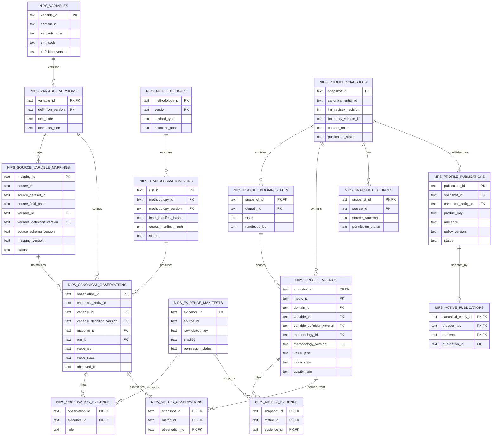

# NIPS Database ERD and Logical Schema — V1

**Status:** Design artifact only. Not a migration. No database, binding, table, or production resource was created or changed.
**Target:** Dedicated NIPS analytical/profile data store (proposed D1: `radar-profile-db`).
**Existing owners:** IRNI geographic registry remains in `radar-neighborhood-db`; accounts/listings remain in `radar-user-db`; behavioral research remains in `radar-researcher-db`.
**Raw evidence:** R2/object storage, not D1 blobs.

## 1. Ownership decisions

| Data | System of record | NIPS stores |
|---|---|---|
| Canonical geography, identity anchors, aliases, hierarchy, registry revision | IRNI / `radar-neighborhood-db` | Canonical entity ID and registry revision references only |
| Reviewed boundary geometry and approvals | IRNI geospatial boundary service | Boundary version/hash/reference and derived spatial metadata; no competing boundary master |
| Source authority, access and redistribution policy | Source Registry (not found in current SQL migrations; owner must be confirmed) | External source IDs and permission snapshot per evidence |
| Raw source files and payloads | R2 evidence objects | Object key, SHA-256, media type, source version, retention and permission metadata |
| Normalized observations and variable mapping | NIPS analytical store (proposed) | Versioned canonical observations, mappings, methods and lineage |
| Assembled profile snapshots | NIPS profile store (proposed) | Immutable snapshots, metrics, domain readiness and publication pointers |
| User accounts, submitted listings, votes and marketplace state | `radar-user-db` | No direct ownership; ingestion adapters may create governed observations |
| Behavioral research events | `radar-researcher-db` | No user/session event data in NIPS |

**Do not** add NIPS profile tables to IRNI, USER_DB or RESEARCH_DB. Do not duplicate canonical IRNI entities, listing ownership records, or individual research events inside NIPS.

## 2. Entity relationship diagram

## 3. Table contracts

### 3.1 Governance/catalog

**nips_variables**
- PK: `variable_id` (stable semantic identifier, not a translated label).
- Fields: `domain_id`, `semantic_role`, `sensitivity_class`, `lifecycle_status`, timestamps.
- This row is the stable concept; it is not overwritten when the definition changes.

**nips_variable_versions**
- Composite PK: (`variable_id`, `definition_version`); FK `variable_id` → `nips_variables`.
- Fields: definition JSON/hash, unit, currency policy, allowed geographic levels, allowed temporal kinds, effective time and approval metadata.
- Immutable. Mappings, observations and profile metrics reference the exact version.

**nips_source_variable_mappings**
- PK: `mapping_id`; FK: `variable_id` → `nips_variables`.
- Fields: external `source_id`, `source_dataset_id`, `source_field_path`, source schema version, mapping version, parser/normalizer reference, unit conversion, semantic role mapping, geographic/temporal interpretation, status, reviewer reference, effective dates.
- Unique key: (`source_id`, `source_dataset_id`, `source_field_path`, `source_schema_version`, `mapping_version`).
- `source_id` deliberately has no local FK until the Source Registry owner and API contract are identified. Do not create a second source master.

**nips_methodologies**
- PK: (`methodology_id`, `version`) or immutable `methodology_version_id`.
- Fields: method type, input/output variable contracts, parameter JSON, code/artifact reference, definition hash, validation requirements, lifecycle, approval metadata.
- Methodology versions are immutable. A correction creates a new version.

### 3.2 Evidence and processing

**nips_evidence_manifests**
- PK: `evidence_id`.
- Fields: `source_id`, `source_record_key`, `received_at`, `observed_at`, `raw_object_key`, `sha256`, `media_type`, `source_version`, `permission_status`, `retention_class`, `lifecycle`, `validation_report_ref`.
- Raw bytes live in R2. The D1 row is a manifest, not a payload store.
- Evidence lifecycle is append/audit oriented. Removal or legal restriction changes the manifest state and triggers profile invalidation/reassembly; it does not silently rewrite historical lineage.

**nips_transformation_runs**
- PK: `run_id`.
- FK: methodology version → `nips_methodologies`.
- Fields: code/build ID, input manifest hash, input watermark JSON, parameter hash, started/completed times, status, output manifest hash, error class, deterministic flag.
- Never store credentials, raw secrets, or unredacted provider responses in logs.

**nips_canonical_observations**
- PK: `observation_id`; FKs: `variable_id`, `mapping_id`, `run_id`.
- Fields: `canonical_entity_id` (IRNI ID, external reference), variable, typed JSON value, state, unit/currency, semantic role, observed time, period start/end, source and target geographic level, boundary version, assignment method, methodology version, supersession pointer, created time.
- Unique deduplication key should be a deterministic hash of entity + variable + source/mapping + source record/period + semantic role + relevant boundary version. Do not use value alone as a uniqueness key.
- Corrections append a new observation and supersede the prior one. Do not update observations in place after they have been consumed by a published snapshot.

**nips_observation_evidence**
- Composite PK: (`observation_id`, `evidence_id`, `role`).
- Many-to-many relation; an observation may be supported by several source artifacts and one artifact may support many observations.

### 3.3 Profile snapshots and metrics

**nips_profile_snapshots**
- PK: `snapshot_id`.
- Fields: canonical entity ID, IRNI registry revision, boundary version/hash/scheme revision, schema version, variable catalog version, source registry revision, methodology catalog version, publication policy version, assembly build ID, source watermark hash, content hash, state, created/assembled/published timestamps.
- A snapshot is immutable after assembly is finalized. Rebuild creates a new snapshot.
- Canonical entity ID is an external IRNI reference; no local FK or copied identity row.

**nips_profile_domain_states**
- Composite PK: (snapshot_id, domain_id); FK snapshot.
- Exactly one row per v1 domain is an assembler invariant (14 rows); SQL enforces valid domain identifiers and metric-to-domain membership.
- Fields: domain state, updated time, publishable/blocked/stale/unavailable counts, reasons JSON, domain data JSON (only for domain-specific non-metric structures; metric values stay normalized).
- Domain IDs must be from the versioned NIPS domain catalog.

**nips_profile_metrics**
- Composite PK: (snapshot_id, metric_id); composite FK to the matching (snapshot_id, domain_id) domain-state row; FK to the exact variable version and methodology version.
- Fields: domain ID, variable ID, semantic role, value JSON, value state, unit/currency, temporal contract JSON, geography contract JSON, methodology ID/version, quality JSON, comparability key, display contract JSON.
- Explicit state/value constraint: states MISSING, UNAVAILABLE, SUPPRESSED and NOT_APPLICABLE require JSON null; zero is a real value, never a missing sentinel.
- The metric row is a snapshot result, not a source observation.

**nips_metric_evidence** and **nips_metric_observations**
- Composite keys attach a snapshot metric to its evidence and source observations.
- These links preserve lineage when a metric is aggregated from multiple observations and evidence records.

**nips_snapshot_sources**
- Composite PK: (`snapshot_id`, `source_id`).
- Captures exact source watermark/version and permission state used by that snapshot. This is necessary for deterministic cache invalidation and reproducibility.

### 3.4 Publication

**nips_profile_publications**
- PK: `publication_id`; composite FK: (`snapshot_id`, `canonical_entity_id`) → snapshot.
- Fields: product key, audience, publication policy version, decision, status, decision timestamp, reviewer/system actor reference, revocation timestamp and reason.
- Unique composite: (`publication_id`, `canonical_entity_id`, `product_key`, `audience`) so the active pointer cannot point across neighborhoods or products.
- A snapshot can be published to more than one product/audience, under separate decisions.

**nips_active_publications**
- Composite PK: (`canonical_entity_id`, `product_key`, `audience`); composite FK: (`publication_id`, `canonical_entity_id`, `product_key`, `audience`) → publication.
- Exactly one active pointer per entity/product/audience, and the FK guarantees it points to a publication for that same entity/product/audience. A partial unique index also prevents two ACTIVE publication decisions for the same entity/product/audience. Switching publication uses a transaction: supersede the old decision, insert the new decision, update pointer, retain history.
- The pointer is a mutable projection; publication and snapshot records remain immutable.

## 4. Cardinality and key rules

- One canonical neighborhood → many profile snapshots.
- One snapshot → exactly fourteen domain-state rows for schema v1.
- One snapshot → zero or many metrics.
- One metric → zero or many evidence links and observation links.
- One canonical observation → one variable mapping and one transformation run; many evidence links.
- One source mapping → one canonical variable; one variable → many mappings.
- One methodology version → many transformation runs.
- One snapshot → many source watermark rows.
- One snapshot → many publication decisions; one active publication pointer per entity/product/audience.
- IRNI IDs, source IDs, boundary version IDs and source registry revisions are external identifiers, not locally re-authored entities.

## 5. Indexes and query paths

Required indexes:
- `nips_profile_snapshots(canonical_entity_id, assembled_at DESC)`
- `nips_profile_snapshots(canonical_entity_id, publication_state, assembled_at DESC)`
- `nips_active_publications(canonical_entity_id, product_key, audience)` (PK already covers)
- `nips_profile_metrics(snapshot_id, domain_id)`
- `nips_profile_metrics(variable_id, value_state)`
- `nips_canonical_observations(canonical_entity_id, variable_id, observed_at DESC)`
- `nips_canonical_observations(variable_id, period_start, period_end)`
- `nips_canonical_observations(deduplication_key UNIQUE)`
- `nips_evidence_manifests(source_id, observed_at DESC)`
- `nips_evidence_manifests(sha256)`
- `nips_transformation_runs(status, completed_at DESC)`

D1 query pattern for a public profile: resolve the active publication pointer → snapshot metadata → 14 domain states → metrics by domain → evidence references only when the caller is authorized. Do not load raw R2 objects in the profile read path.

## 6. Write and publication transactions

1. Ingest source artifact to R2; verify media type/size/hash; create evidence manifest.
2. Resolve source mapping and variable version. If absent or ambiguous, quarantine; do not infer.
3. Normalize into canonical observations; attach evidence; record deterministic transformation run.
4. Validate geography, time, unit, state/value semantics, permission and lineage.
5. Assemble a new immutable profile snapshot from a pinned set of observation IDs and source watermarks.
6. Write domain states, metrics, metric-evidence links, metric-observation links and snapshot source watermarks.
7. Validate snapshot completeness, policy gates and content hash.
8. Create publication decision and update active pointer atomically. If a gate fails, keep snapshot DRAFT/PROVISIONAL and do not move pointer.
9. Permission revocation, boundary revision, observation correction, or methodology/catalog update marks dependent snapshots stale and queues reassembly; it never silently edits published content.

## 7. D1-specific implementation constraints

- Use SQLite/D1-compatible types and constraints. JSON is stored as validated TEXT; add `CHECK(json_valid(...))` where appropriate.
- Avoid assuming Postgres features, native arrays, JSONB, spatial indexes or deferred constraints.
- D1 foreign keys must be enabled and verified in the actual runtime/migration path. Cross-database FKs are impossible; IRNI/source registry references require service-level validation.
- Keep raw binary/source payloads out of D1; R2 is the object store.
- Keep observation and metric tables append-oriented; use lifecycle/supersession rather than destructive updates.
- Use bounded pagination for history and evidence; never return unbounded metrics/evidence in a single endpoint.

## 8. Decisions still requiring evidence before a migration

1. The repository has a candidate source registry in server/modules/ingestion-intelligence-pipeline, but it is not yet an authoritative NIPS dependency: its service starts with an empty in-memory source Map, has no demonstrated hydration/list repository, status updates are Map-only, and its route factory is not mounted by apps/api/server.ts. See NIPS-SOURCE-REGISTRY-INGESTION-AUDIT-V1.md. Repair and verify this owner before NIPS integration; do not create a parallel registry.
2. Confirm the current production D1 inventory and free-tier capacity before provisioning a fourth D1 database. No paid plan or usage upgrade is implied or authorized.
3. Confirm whether evidence metadata belongs in NIPS D1 or a separately governed Evidence Registry. This ERD uses NIPS manifests as the initial proposal, with R2 as raw object storage.
4. Confirm boundary service's stable read contract and identifiers; do not copy boundary geometry into NIPS.
5. Decide if the domain-specific `data` object should be JSON per domain or decomposed into typed child tables. This ERD keeps core metrics normalized and permits limited domain JSON for non-metric aggregates.
6. Decide whether a separate `nips_variable_versions` table is needed in the first migration. It is recommended if variable definitions must be historically reproducible.

## 9. Explicit non-actions

- No migration SQL has been placed in an active migration directory.
- No D1 database or binding has been created.
- No Cloudflare migration, production write, deployment, or schema mutation has been run.
- No existing dirty working-tree file was reverted or overwritten as part of this ERD task.

## Publication policy contract addendum

- Policy identity is (product_key, audience, policy_version); publication decisions pin that exact policy version.
- Policy configuration defines required domains, allowed domain states, blocked-metric ceiling, and optional per-required-domain minimum publishable metric counts.
- The default public profile policy requires identity, geography, and evidence to be READY. Optional analytical domains may be READY, PARTIAL, UNAVAILABLE, or NOT_APPLICABLE. STALE and BLOCKED are rejected by default.
- Policy changes create new publication decisions; they do not mutate historical snapshots or decisions.
- A policy pass does not override independent source permission, privacy, canonical identity, boundary, evidence-integrity, or audience-serialization gates.
- The default policy is a code-level baseline only. It does not imply that any current profile is eligible for production publication.
