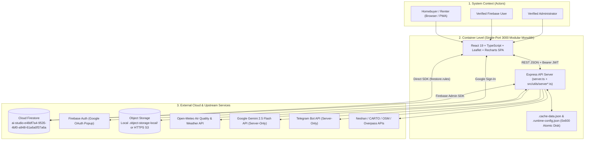
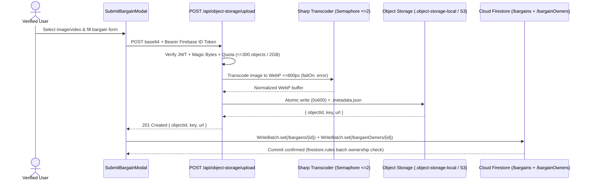

# System Architecture — Tehran Housing Radar (رادار مسکن)

> **Authoritative Policy & Guardrails**: See [`/ARCHITECTURE.md`](../ARCHITECTURE.md) for strict module dependency rules, the `< 500` line ceiling on implementation files, and the legacy file ratchet (`architecture-baseline.json`).

## 1. High-Level Topology & C4 Architecture Model (Prompt 542)

- **Component & Code Layer Hierarchy (`ARCHITECTURE.md`)**:
  - `src/App.tsx` & `server.ts` (Composition roots) → `src/components/*` (UI & hooks) → `src/data/*` (Pure domain datasets, Hedonic engine, legal & tax calculators) → `src/utils/*` (Security, storage, API contracts, caching, governance) → `src/types/models.ts` (Canonical TypeScript interfaces & runtime type guards).

---

## 2. Runtime Communication Sequence Flows (Prompt 543)

### 2.1 Authenticated Property Media Upload & Bargain Creation

---

## 3. Firestore Data Model & Collection Dictionary (Prompt 544)

Database ID: `ai-studio-e48df7a4-9535-4bf0-a948-61a6a0f37a6a` (Project: `gen-lang-client-0713157837`).

| Collection Path | Document ID Strategy | Public Read? | Write Authorization (`firestore.rules`) | Key Fields & Constraints |
| :--- | :--- | :--- | :--- | :--- |
| `/votes/{voteId}` | Deterministic: `${uid}_hood_${hoodId}` | Owner or Admin | Verified owner (`24h` cooldown on `update`) | `userId`, `hoodId` (`1..999`), `vote` (`'up' \| 'down'`), `createdAt`, `lastUpdatedAt` |
| `/bargains/{bargainId}` | Auto ID / UUID | Public (`get` & bounded `list`) | Verified owner with matching `/bargainOwners/{bargainId}` in batch, or Admin | `hoodId` (`1..999`), `title`, `type`, `sqm` (`25..1000`), `priceText`, `discountPercent` (`1..60`), optional `imageUrl` / each `imageUrls` member / `videoUrl` (max 600 characters), `objectStorageKeys` (`<=6`) |
| `/bargainOwners/{bargainId}` | Matches `bargainId` | Owner or Admin (`list: false`) | Verified owner on `create`; Owner/Admin on `delete` | `userId` (`== request.auth.uid`), `createdAtIso` |
| `/buyerAlerts/{alertId}` | Deterministic: `${uid}_hood_${hoodId}` | Owner or Admin (`list`: Admin) | Verified owner (`^09[0-9]{9}$` phone) | `userId`, `hoodId` (`1..999`), `hoodName`, `fullName`, `phone`, `dealType`, `maxBudgetText`, `expiresAtIso` |
| `/sponsorRequests/{requestId}` | Auto ID | Admin only | Verified user (`status == 'pending'`); Admin for `update`/`delete` | `hoodId` (`1..999`), `agencyName`, `phone`, `specialty`, `experienceYears`, `monthlyTariffMillion`, `status` |
| `/neighborhoodOverrides/{hoodId}` | `<hoodId>` or `hood_<hoodId>` (`1..999`) | Public `get`; `list` only when `hoodId` is `1..999` | Verified Admin only (`isValidNeighborhoodOverride`, including `isValidOverrideSponsor`) | `hoodId` (`1..999`), `buyPerSqm` (`10..5000`), `rahn80m` (`50..100000`), `updatedAt`, optional `neighborhoodOverrides.sponsor` (`name`, `phone`, `specialty`, `experienceYears`, `expiresAtIso`, `planType`) |
| `/appConfig/{configId}` | `'featureFlags'` or `'monetization'` | Public `get` (`list: false`) | Verified Admin only (`delete: false`) | Boolean feature flags (`isValidFeatureFlags`) or monetization settings |
| `/userPreferences/{userId}` | `${request.auth.uid}` | Owner or Admin | Verified owner | `userId`, `favoriteHoodIds` (`list <= 25`, integers `1..999`), `updatedAtIso` |
| `/admins/{adminId}` | `${uid}` | Verified Admin (`role == 'admin'`) | Managed out-of-band (`allow write: if false`) | `role: 'admin'`, `email` |
| `/socialPosts/{postId}` & `/socialComments/{commentId}` | Generated Stage 3 ID (`isValidId`) | Public where visible & not soft-deleted; Admin/Author | Verified owner on create/edit; Admin for moderation | Unified discussions, Q&A, corrections, and research proposals (`titleFa <= 160`, `bodyFa <= 600`) |
| `/socialReactions/{reactionId}`, `/socialFollows/{followId}`, `/socialProfiles/{userId}` | Owner-scoped / UID | Private reactions/follows; profile per `visibility` | Verified owner matching `request.auth.uid` | Zero raw PII; reactions & follows deduplicated server-side |
| `/socialReports/{reportId}` & `/socialIdempotency/{keyId}` | Report / Key ID | Reporter `get` or Admin; Admin for idempotency | Verified reporter on submit (`status == 'submitted'`); Admin update | Confidential abuse reports, appeals, and mutation idempotency ledger |
| `/socialModerationCases/{caseId}` | `case_{targetType}_{targetId}` | Admin only | Server / Verified Admin only (`isAdmin() && isValidId(caseId)`) | `targetType`, `targetId`, `status` (`OPEN..CLOSED`), `reportCount`, `claimedByUid`, `lastDecision` |
| `/socialModerationEvents/{eventId}` | Generated event ID | Admin only | Append-only create (`allow update, delete: if false`) | `caseId`, `targetId`, `eventType`, `actorUid`, `createdAtIso` |
| `/socialOutbox/{outboxId}` | Generated outbox ID | Admin only | Server / Verified Admin only (`isAdmin() && isValidId(outboxId)`) | `eventType`, `schemaVersion`, `status` (`PENDING..DEAD_LETTER`), `attemptCount`, zero PII |
| `/socialRateLimits/{rateLimitId}` | `sha256("${bucket}:${uid}")` | None (`false`) | Server Admin SDK only (`allow read, write: if false;`) | `bucket`, `subjectHash` (SHA-256), `count`, `windowStartMs`, `expiresAtMs`, `updatedAtIso` |
| `/socialActivities/{activityId}` | `sha256("${eventType}:${objectId}")` or follow/reaction hash | None (`false`) | Server Admin SDK only (`allow read, write: if false;`) | `eventType`, `actorUid`, `objectType`, `objectId`, optional `parentObjectId`, optional `socialContext`, `visibility`, `createdAtIso`, `schemaVersion: 1` |
| `/socialFeedIndex/{indexId}` & `/socialFeedIndexJobs/{jobId}` | `sourcePostId` / Job ID | None (`false`) | Server Admin SDK only (`allow read, write: if false;`) | Derived feed/search projection (`normalizedSearchTokens <= 40`, `excerptFa <= 180`, `feedScore`, `visibility`, zero raw `bodyFa`) and paged rebuild job lock |

> **Wave-1 Platform Extensions (Stages 4–28)**: See [`docs/architecture/wave1-stages-4-to-28.md`](./architecture/wave1-stages-4-to-28.md) for the Modular Monolith implementation across Trust & Safety, Durable Outbox, Persian Social Search/Feed, Governed Telemetry, Resilience, Cost/Release Governance, Legal/Commercial Readiness, AI Orchestration, Integration Gateway Pilot, Data Exchange Lifecycle, and Market Intelligence.

## 4. Epistemic Market Pricing (UI ↔ Aggregator)

Neighborhood deal/spread numbers shown in map-adjacent UI (Compare, Inspector market tab, Intelligence, Bargains) must share one sampling path:

- **Canonical samples**: `buildNeighborhoodListingSamples(hood)` in `src/data/neighborhoodListingSamples.ts` — only `live-divar-*` rows enter the mean, IQR, and coverage index. Seed catalog bargains are educational cards and are excluded. With zero live rows, `estimatedDealPricePerSqm` stays on the reference baseline (`askToDealRatio = 1`).
- **Dated Tehran reference**: `TEHRAN_DATED_REFERENCE_PRICES` (hood ids 1–20, آبان ۱۴۰۵) is an internal editorial table, not a registered-transaction series. Map tooltip and inspector use `formatNeighborhoodPriceTruthFa`.
- **UI entry point**: `aggregateHoodMarketForUi` / `aggregateMarketMetricsForHood` in `src/data/aggregateHoodMarketForUi.ts` — UI must not call `aggregateNeighborhoodMarketMetrics(..., [])`.
- **Labels**: `displayDealLabelFa`, `isDealPriceDisplayableAsFact`, and `FORBIDDEN_DEAL_FACT_LABELS` in `src/utils/epistemicUiLabels.ts` (forbidden: implying verified closing price without `verifiedTransactionCount > 0`).
- **Banner**: `EpistemicMarketDisclaimer` when deal price is heuristic or lacks verified transactions.

Provenance fields consumed by UI: `provenance`, `evidenceSufficiency`, `observedSampleCount`, `confidenceScore`.

