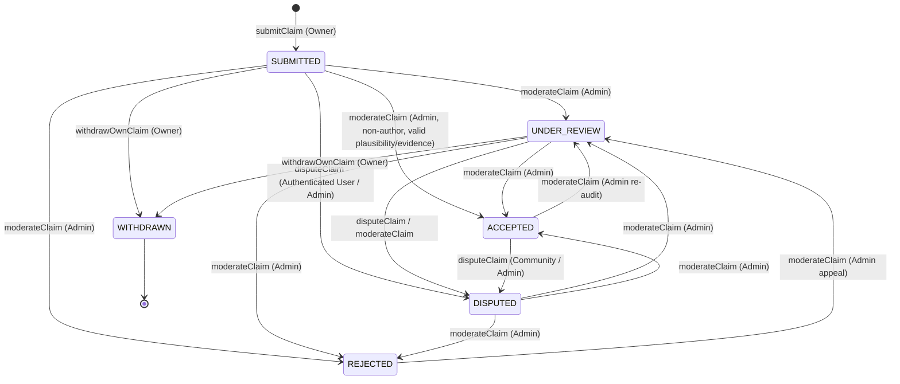
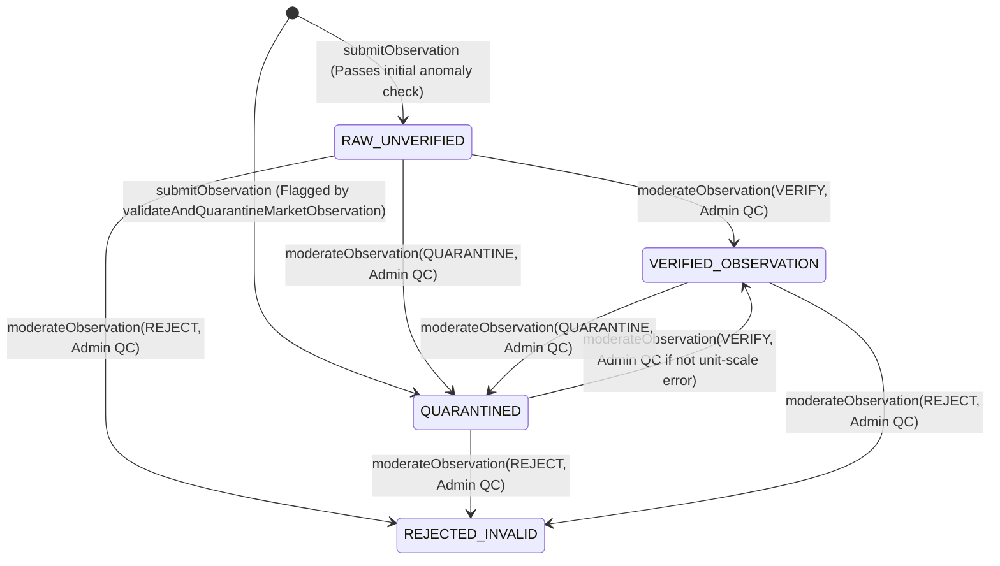

# Employee 4 — Crowd Claims and Market Observations Backend (`server/modules/crowd-data/`)

## 1. Existing Repository Review & Reuse Mapping

Before implementing `server/modules/crowd-data/`, the existing repository was audited to avoid duplicating verified logic in `main`:

| Existing Module | Inspected Capabilities | Reuse Decision in `server/modules/crowd-data/` |
|---|---|---|
| `src/cells/knowledge-crowd/crowdClaimsEngine.ts` | `normalizeStreetName`, `evaluateClaimPlausibility`, `DEFAULT_INITIAL_TRUST_WEIGHT` | **Reused directly** for Persian street normalization and baseline price deviation plausibility checks (`±15%` plausible, `>45%` rejected outlier). |
| `src/utils/marketHistoryAndPulseIntegrity.ts` | `validateAndQuarantineMarketObservation`, `filterAndAggregateScrapedSamples` | **Reused directly** for market observation unit-scale / extreme-outlier quarantine and IQR statistical aggregation (`median`, `Q1`, `Q3`, `IQR`). |
| `src/utils/marketDataIntegrity.ts` | `validateCityNeighborhoodScope`, `computeTokenSimilarity`, `sanitizeSafeExternalUrl` | **Reused directly** for city-neighborhood scope validation, duplicate claim similarity scoring, and external evidence URL sanitization. |
| `src/utils/buyerCorrectionAndAdminGovernance.ts` | `CORRECTABLE_FIELD_METADATA` | **Reused directly** to validate `NEIGHBORHOOD_ATTRIBUTE_CORRECTION` claim field keys. |
| `src/data/multiCityData.ts` & `src/data/neighborhoods.ts` | `MULTI_CITY_CONFIGS`, `INITIAL_NEIGHBORHOODS` | **Reused directly** in `validateAuthoritativeNeighborhoodReference` to reject non-existent neighborhood IDs and cross-city mismatches. |
| `src/utils/serverAdminAndTelegramSecurity.ts` | `getFirebaseAdminFirestoreForServer` | **Reused directly** in `persistenceAdapter.ts` for durable Firestore persistence. |

---

## 2. State Diagrams

### 2.1 Crowd Claims Lifecycle State Machine (`CrowdClaimLifecycleState`)

Crowd claims are user assertions (`UNVERIFIED_CROWD_CLAIM` / `MODERATED_CROWD_CLAIM`) and **never** transition into market observations (`authoritativeDataEligible: false`).

### 2.2 Market Observations Verification State Machine (`ObservationVerificationState`)

Market observations have an independent lifecycle and trust model (`RAW_MARKET_OBSERVATION` -> `VERIFIED_MARKET_OBSERVATION`).

---

## 3. Provenance & Epistemic Separation Model

| Epistemic Tier | Classification Constant | Firestore Collection | Trust & Analytics Eligibility |
|---|---|---|---|
| **Tier 0** | `UNVERIFIED_CROWD_CLAIM` | `crowd_claims_v2` | Raw user-submitted claim (`SUBMITTED`, `UNDER_REVIEW`, `DISPUTED`, `REJECTED`, `WITHDRAWN`). Never used in market metrics (`authoritativeDataEligible: false`). |
| **Tier 1** | `MODERATED_CROWD_CLAIM` | `crowd_claims_v2` | Moderator-accepted user claim (`ACCEPTED`). Displayed as community insight with provenance, but **never** converted into a market observation (`authoritativeDataEligible: false`). |
| **Tier 2** | `RAW_MARKET_OBSERVATION` | `market_observations_v2` | Structured observation in `RAW_UNVERIFIED`, `QUARANTINED`, or `REJECTED_INVALID` state. Excluded from derived market metrics. |
| **Tier 3** | `VERIFIED_MARKET_OBSERVATION` | `market_observations_v2` | Admin/QC verified observation (`VERIFIED_OBSERVATION`) within its `[validFromIso, validUntilIso]` window. Eligible for analytical aggregation. |
| **Tier 4** | `DERIVED_MARKET_METRIC` | Computed via `aggregateVerifiedMarketObservations` | IQR-filtered median/Q1/Q3/confidence computed strictly from active Tier 3 observations. Returns `null` (`INSUFFICIENT_VERIFIED_OBSERVATIONS`, `syntheticFallbackUsed: false`) when active verified observations are absent. |

---

## 4. Integration Handoff Report

### 4.1 Module Entry Points (`server/modules/crowd-data/index.ts`)
- `createCrowdDataModuleFacade(customStore?)`: Instantiates `{ store, crowdClaims, marketObservations }`.
- `CrowdClaimsDomainService`:
  - `submitClaim(actor, request, nowMs?)`
  - `updateOwnClaim(actor, request, nowMs?)`
  - `withdrawOwnClaim(actor, claimId, reason, expectedRevision?, nowMs?)`
  - `moderateClaim(actor, request, nowMs?)`
  - `disputeClaim(actor, claimId, disputeReason, expectedRevision?, nowMs?)`
  - `getClaimById(claimId)`
  - `listNeighborhoodClaims(cityId, hoodId)`
- `MarketObservationsDomainService`:
  - `submitObservation(actor, request, nowMs?)`
  - `moderateObservation(actor, request, nowMs?)`
  - `aggregateVerifiedMarketObservations(cityId, hoodId, nowMs?)`
  - `getObservationById(observationId)`
  - `listNeighborhoodObservations(cityId, hoodId)`

### 4.2 Upstream Handoff Prerequisites (For Shared Route / Rules Owner)
Per Employee 4 scope restrictions, `server.ts`, `firestore.rules`, and `firestore.indexes.json` were **not** modified. The integration owner should wire:
1. **Firestore Collections**:
   - `crowd_claims_v2/{claimId}`: Owner read/create/update (when `authorUid == request.auth.uid`), Admin moderation write.
   - `market_observations_v2/{observationId}`: Authenticated ingestion create, Admin QC moderation write.
2. **Composite Indexes**:
   - `crowd_claims_v2`: `(cityId ASC, hoodId ASC, createdAtIso DESC)`
   - `market_observations_v2`: `(cityId ASC, hoodId ASC, verificationState ASC, validity.validUntilIso DESC)`
