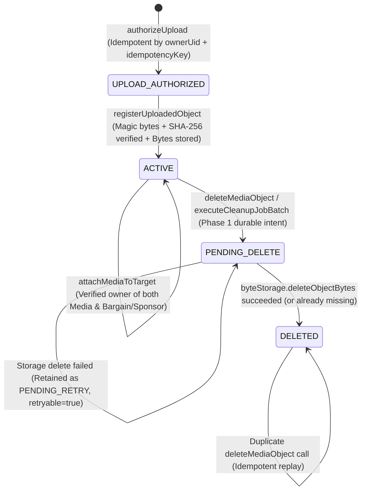

# Employee 6 — Media and Object Storage Backend Module (`server/modules/media/`)

## 1. Existing Repository Review & Reuse Mapping

| Existing Repository File | Inspected Capability | Reuse Decision in `server/modules/media/` |
|---|---|---|
| `src/utils/objectStorage.ts` | `ALLOWED_IMAGE_MIMES`, `ALLOWED_VIDEO_MIMES`, `buildListingObjectKey`, `ObjectStorageProviderId` | **Reused directly** for MIME allowlists and hierarchical object key generation (`listings/{city}/hood-{hoodId}/{mediaType}/{yyyy-mm}/{objectId}.{ext}`). |
| `src/utils/objectStorageUpload.ts` | `resolveObjectStorageRuntimeConfig`, `buildValidatedS3TargetUrl`, `uploadToRemoteS3Compatible`, `downloadFromRemoteS3Compatible`, `deleteFromRemoteS3Compatible` | **Reused directly** inside `ConfiguredS3ByteStorageProvider` for AWS SigV4 authenticated HTTPS transfers and SSRF/endpoint validation. |
| `src/utils/serverObjectStorageHelpers.ts` | `validateMediaMagicBytesAndExtension`, `parseSingleByteRange`, `MAX_OBJECTS_PER_OWNER`, `MAX_BYTES_PER_OWNER` | **Reused directly** for binary magic-byte signature validation, HTTP Range slicing, and per-owner quota enforcement. |
| `src/utils/marketDataIntegrity.ts` | `validateCityNeighborhoodScope` | **Reused directly** to validate `(cityId, hoodId)` on upload authorization. |

---

## 2. Storage Provider Abstraction & Production Safety Rules

### 2.1 `MediaByteStorageProvider` Contract (`server/modules/media/storageProvider.ts`)
- `getHealthStatus(): StorageProviderHealthStatus`
- `putObjectBytes(internalKey, bytes, mimeType): Promise<ByteObjectPutResult>`
- `getObjectBytes(internalKey, rangeHeader?): Promise<ByteObjectGetResult | null>`
- `headObjectExists(internalKey): Promise<boolean>`
- `deleteObjectBytes(internalKey): Promise<ByteObjectDeleteResult>`
- `listStoredObjectKeys(): Promise<string[]>`

### 2.2 Storage Integrity Invariants
1. **Firestore Metadata vs Object Bytes Firewall**: `assertMetadataContainsNoRawBytes` enforces that `MediaMetadataRecord` never contains `Buffer`, `Uint8Array`, `dataBase64`, or storage credentials (`METADATA_RAW_BYTES_VIOLATION`).
2. **No Silent Local Filesystem Production Storage**: When `environmentMode === 'production'`, `EPHEMERAL_DEV_FILESYSTEM` providers fail closed with `PRODUCTION_DURABLE_STORAGE_NOT_CONFIGURED` (`503`).
3. **No Invented R2/S3 Deployment**: `ConfiguredS3ByteStorageProvider` verifies `cfg.s3CredentialsConfigured` and `buildValidatedS3TargetUrl` before operating. When credentials or allowlisted endpoints are absent, it reports `durabilityTier: 'UNCONFIGURED_DISABLED'` and fails closed (`503`).
4. **Zero Credential & Unrestricted Key Exposure**: `toPublicMediaDescriptor` strips `internalObjectKey`, bucket names, and internal grant IDs, exposing only `/api/media/objects/{objectId}`.

---

## 3. Media Object Lifecycle & Two-Phase Deletion Recovery



---

## 4. Integration Handoff Report (Bargains, Sponsors, Routes & Firestore)

### 4.1 Explicit Media-Reference Interface for Bargains & Sponsors
Per Employee 6 restrictions, Bargains and Sponsors modules were **not** modified. Those modules integrate with `server/modules/media/` by implementing `MediaTargetEntityVerifier`:

```ts
export interface MediaTargetEntityVerifier {
  verifyTargetEntity(
    targetType: 'BARGAIN' | 'SPONSOR',
    targetId: string
  ): Promise<{
    exists: boolean;
    ownerUid: string | null;
    declaredMediaObjectIds?: readonly string[];
  }>;
}
```

When `mediaService.attachMediaToTarget(actor, { objectIds, targetType, targetId }, verifier)` is called:
1. It verifies `actor.uid === media.ownerUid` for every `objectId`.
2. It verifies underlying object bytes exist in `byteStorage` (`headObjectExists`).
3. It calls `verifier.verifyTargetEntity(targetType, targetId)` and enforces `exists && ownerUid === actor.uid`.
4. It atomically binds `association: { targetType, targetId, attachedByUid, attachedAtIso }`.

### 4.2 Firestore Collections & Indexes for Shared Rules Owner
- `media_upload_grants_v2/{grantId}`: Short-lived upload authorization grants (`ownerUid`, `idempotencyKey`, `expiresAtIso`).
- `media_object_metadata_v2/{objectId}`: Durable media metadata (`ownerUid`, `state`, `association.targetType`, `association.targetId`, `sha256`).
- `media_cleanup_jobs_v2/{jobId}`: Checkpointed admin orphan-cleanup jobs (`status`, `cursorIndex`, `items`).
